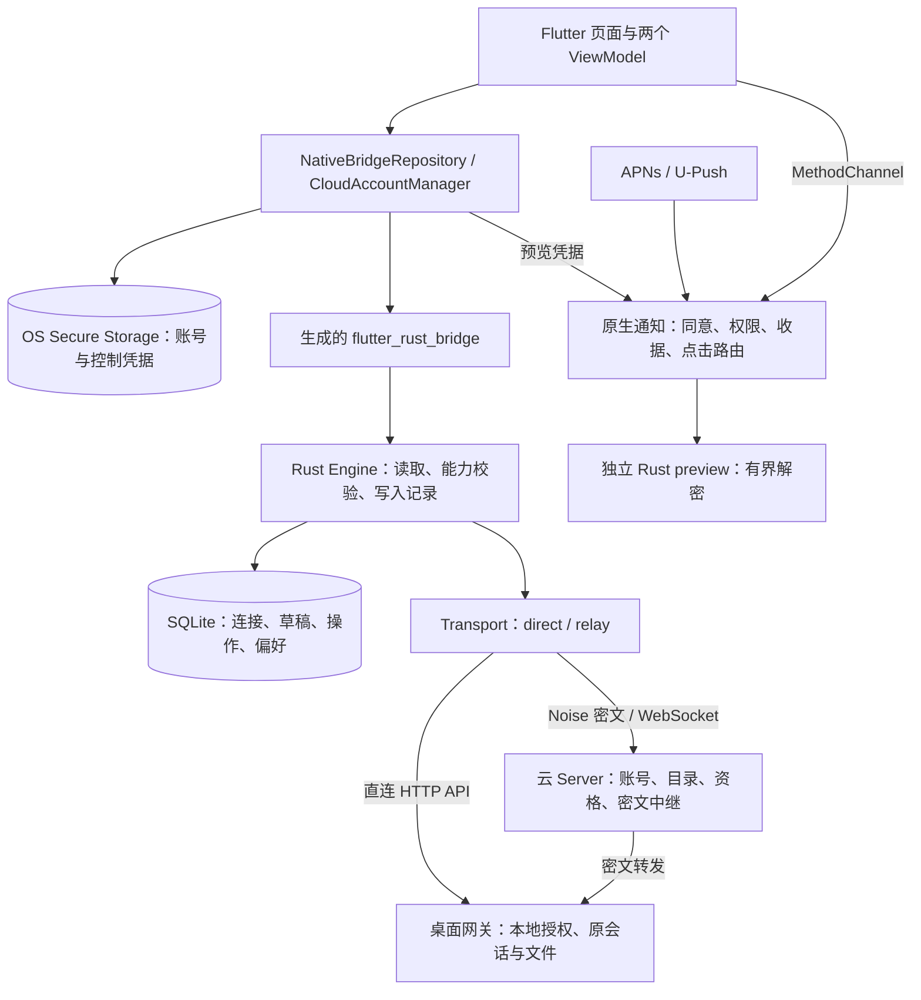
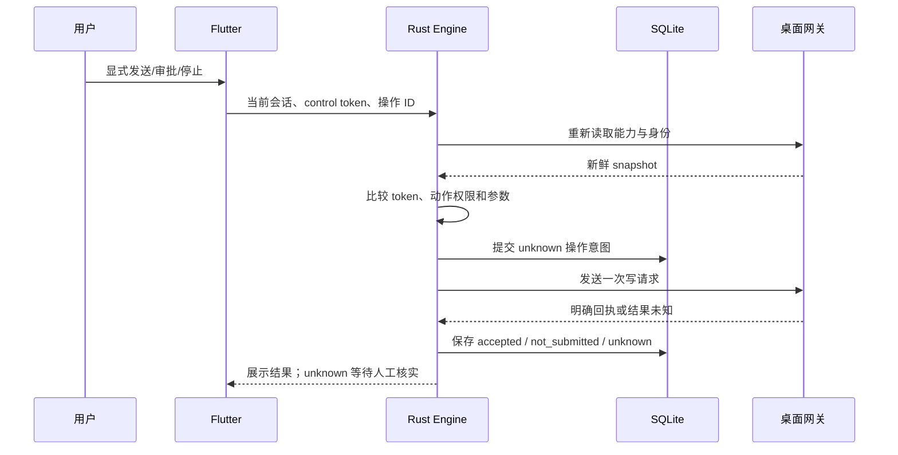

# Agent Note: App 全局架构、跨层状态与范围省察

Status: implemented

## Problem

App 同时维护界面选择、网关认证、云账号、设备信任、连接许可和通知同意。单层测试通过不能证明这些状态在关闭后恢复、切换账号、原生存储失败等组合下仍一致。维护者需要一份全局记录，辨认哪些权限由服务器或桌面决定，哪些状态仅供显示，以及失败会传播到哪里。

本篇描述当前 App 的分工、数据和关键操作链路，并留下可复现的偏离与验证缺口，供检查整体逻辑。它不替代客户端协议说明或发布验收。

## Decision

App 使用 Flutter 承担界面、交互和生命周期，手机上的 Rust 核心承担网关协议、认证、端到端加密、操作前校验与 SQLite 持久化；Android/iOS 原生代码承担系统通知、设备密钥保护和通知预览。AI 工具、原桌面会话及文件实际操作仍由桌面网关和原编码客户端执行。

连接显式区分 `direct` 与 `relay`，保存格式要求连接类型明确。云账号发现设备不等于授权，桌面本地可信密钥和“允许连接”仍是业务访问前提。通知预览只拥有独立预览密钥，不获得控制能力。未知写入保留待核实记录，不自动重放。

**总体分工仍符合目标，省察复现的跨层状态缺口现已修复。** A1–A4 的真实 FFI 回归、HTTP origin 一致性、构建快照和旧接口清理均有对应实现。原始失败证据继续用于解释为何需要这些边界。

修复决定见[云状态边界](../bug-fix/2026-11-04-cloud-state-boundaries-and-legacy-removal.md)，旧数据兼容的后续取舍见[当前存储格式](../simplification/2026-11-04-current-cloud-storage.md)。本篇区分修复前证据和当前处置，不将源码回归等同于签名或真机验收。

## 范围与记录归属

省察日期为 2026-11-04（Asia/Shanghai），对象是本地 `codex-mobile-bridge-app` 工作树，HEAD 为 `739391c`。审查开始前已有未提交的首页在线筛选、WebSocket TLS、依赖及文档改动；本篇包含这些工作树内容，不能仅用 HEAD 代表。

覆盖 Flutter 启动、两个 ViewModel、repository、云账户和通知控制器，Rust transport/relay/engine/adapters/persistence，原生预览、通知同意、iOS 扩展，以及构建与测试入口。原生 UI、设备 Keychain/Keystore、实际推送送达、签名和打包没有在本次重新验收。生产云服务及真实账号未参与测试。

新建前检索本仓 AGENTS/CLAUDE、ADR/decisions、笔记树，以及 cloud、account、notification、架构等关键字，处理结果如下：

| 现有记录 | 归属与处理 |
| --- | --- |
| `.agents/notes/`、`docs/adr/`、`docs/decisions/` | 均不存在，没有 proposed / implemented / rejected 旧笔记可同步、合并或归档；本篇是首份全局架构记录。 |
| [中文 README](../../../../README.md)、[英文 README](../../../../README.en.md) | 部分重叠：保留用户功能与连接入口，互链到本篇。 |
| [网关协议](../../../../docs/protocol.md) | 部分重叠：继续持有网关操作与身份约定，互链；其 HTTP 限制描述与当前实现不一致，列为文档缺口。 |
| [云连接与通知](../../../../docs/cloud-notifications.md)、[隐私清单](../../../../docs/privacy.md) | 部分重叠：继续持有原生通知、数据与同意说明，互链；短期邀请、HTTP 和关闭后的撤回语义需按下文核对。 |
| [分发说明](../../../../docs/distribution.md)、[发布检查](../../../../docs/release-checklist.md) | 保留构建、签名和真机要求；本篇只记录这些检查与当前代码证据的关系。 |
| Server 的 `2026-11-03-server-architecture-and-scope-audit.md` | 另一仓库持有的服务端省察；其 F1 与本篇 A3 相关。本次另核对 `internal/store/push.go`，服务端撤回入口仍先要求 active binding。 |

没有改写历史决定或删除、归档已有文档。以后若更换控制或通知的信任模型，应另立决定并互链；普通路径、参数和验证事实变化优先就地同步。

## 系统与信任关系



Flutter 保存“用户选中了什么、显示哪一页”；它的 `fresh`、generation 和按钮状态防止迟到结果更新界面，不能代替 Rust 的新鲜状态校验。Rust 的 control token 是当前账号、会话、能力、审批、运行时与当前轮次等信息的指纹，也不是服务器授予的通用 bearer 权限。

云 Server 可以路由和拒绝设备，桌面持有最后一层本地许可。手机在握手中确认固定的桌面控制公钥，首次配对证明还绑定独立预览公钥及两端安全码；服务器目录的 `active` 不能替代这些校验。预览库没有账号、控制或联网 API，收到推送不意味着可以发送消息或批准操作。

## 模块和数据所有权

| 所有者 | 负责什么 | 关键入口 |
| --- | --- | --- |
| Flutter 启动与页面 | Rust 初始化、页面组合、系统生命周期、通知点击和交互提示 | [main](../../../../lib/main.dart)、[app](../../../../lib/app.dart) |
| BridgeViewModel | 当前电脑/provider/会话、历史与草稿、操作状态、前后台失效 | [bridge_view_model](../../../../lib/viewmodels/bridge_view_model.dart) |
| CloudViewModel | 当前服务器/云账号、服务资格、目录轮询、发现状态和连接可用性 | [cloud_view_model](../../../../lib/viewmodels/cloud_view_model.dart) |
| Repository / AccountManager | 原生 client 生命周期、凭据串行写入、云账户轮换与本地阻断 | [repository](../../../../lib/data/bridge_repository.dart)、[cloud_accounts](../../../../lib/data/cloud_accounts.dart) |
| Rust Engine / adapters | 各 provider 的列表/历史/控制映射，写前重新核对、取消读取 | [engine](../../../../rust/src/engine.rs)、[adapters](../../../../rust/src/adapters/mod.rs) |
| Rust Transport / Relay | origin、Cookie/CSRF、TLS、Noise、帧和流量窗口、HTTP 响应限制 | [transport](../../../../rust/src/transport.rs)、[relay](../../../../rust/src/relay.rs) |
| 原生通知与 preview | 同意版本、OS 权限、通知显示、预览密钥、持久收据和点击核验 | [Android CloudPreview](../../../../android/app/src/main/kotlin/dev/waken/bridge_mobile/CloudPreview.kt)、[iOS CloudPreviewService](../../../../ios/CloudShared/CloudPreviewService.swift)、[Rust preview](../../../../rust_preview/src/lib.rs) |

`bridge.sqlite` 使用 WAL、`synchronous=FULL` 和事务，schema 为 v3。`computers` 保存直连地址或云绑定元数据；同 origin 下可有多个 relay，direct 地址仍唯一；既有 computer ID 的地址、连接类型和绑定身份不能原地替换。`drafts` 保存正文和附件引用，`operations` 保存操作摘要、结果与待核实状态；完整聊天历史不落入这里。

| 数据 | 保存位置与作用域 |
| --- | --- |
| 直连 Cookie、CSRF、draft identity | OS secure storage，以 computer ID 保存，Rust 再核对精确 base URL |
| 云账户索引、access/refresh、安装身份和控制私钥 | OS secure storage，精确 origin（含 scheme/端口）+ account ID；刷新先保存已消费状态，再发送网络请求 |
| relay binding 的 device token、控制/预览私钥、固定公钥和安全码 | 每个 computer 的 secure storage；重新登录须将同安装身份的新 token 写回各 binding |
| 草稿和普通未知操作 | SQLite，scope 含 computer/provider/执行环境/session/账号身份；新建聊天的查询例外见 A4 |
| 聊天展示内容、附件字节 | 有界进程内存；消息列表最多保留 500 条，单次文件上限 20 MiB |
| Android 预览密钥与收据 | Android Keystore 包装的 AES-GCM preferences；收据和静默基线不保存预览正文 |
| iOS 预览密钥与收据 | 独立共享 Keychain group 和 App Group JSON；设备本地、元数据排除备份，原子写入并 fsync |

账号或设备退出、通知撤回和永久撤销不是同一种清理。退出保留安装/密钥身份供显式登录恢复，移除本地预览并阻断旧 client；它不证明网络另一端已经撤销会话。云设备在 UI 中不可删除，离线隐藏也不删除本地身份。存储失败时需要分别记录“本地已阻断”和“远端未确认”，不能合成一个成功标志。

## 连接与发现链路

直连从 [GatewayAddress](../../../../rust/src/security.rs) 解析精确 origin 和可选 `/d/<32 hex>` 路径；配对秘密只在 fragment 输入中读取，不保存成地址。登录或配对后读取 `/api/auth`，保存 Cookie/CSRF 和网关身份。HTTP 重试和重定向被关闭；旧请求的 401 只使匹配的认证 epoch 失效，避免撤销后来的登录。

当前 Rust 明确接受 HTTP 与 HTTPS，包括公开 HTTP 地址；不会因 HTTPS 失败自动降级。HTTP 的账号凭据和直连内容没有 TLS 保护，这属于当前显式传输选择。HTTPS/WSS 检查证书；工作树中的 WSS 实现使用显式 platform verifier connector，Android 在任何 FFI 网络调用前初始化应用上下文。Android 本地 TLS companion 固定 0.2.0 JNI ABI，CRL 不可判定状态采用已有 best-effort 策略，确认撤销及其他证书错误仍拒绝。源头与限制见 [TLS companion](../../../../third_party/rustls-platform-verifier/README.md)。

云连接的正常次序是：

1. AccountManager 登录所选 origin，复用同账号既有安装身份与控制密钥，在服务器登记手机并保存新 token。账户写入和 token 轮换串行化；设备目录读取使用单独的凭据租约，慢读取不持有整个账号写入队列。
2. CloudViewModel 在登录/恢复/回到前台时读同账号目录，前台通常每 3 秒同步，失败退避至最多 30 秒。服务资格单独刷新；切服、退出或后台会取消 discovery HTTP/证明读取，并丢弃过期 generation 的结果。
3. 新关系先持久化 binding 身份和秘密，再交换 Noise 证明。协议是 `Noise_KK_25519_ChaChaPoly_BLAKE2s`，prologue 绑定 origin、gateway、binding、channel 和双方控制公钥。控制与预览各用一套密钥。
4. 桌面首次核对安全码并允许连接后，App 的目录状态、配对状态及本地固定身份才共同允许选择设备。发现和授权更新不会自动进入聊天。首页只显示当前账号在线云设备；待允许的在线设备仍可查看安全码。
5. 用户选择设备后，Rust 经加密中继读取桌面 `/api/auth` 和业务 API。每个 relay HTTP 请求创建自己的 WebSocket/Noise 通道，正文通过 4 条 credit 窗口流转；输出接收队列有界。它不是一条跨所有请求复用的永久业务连接。

云服务中心的服务器选择仅在未登录时显示，登录后旧回调也不能自动退出并切服，见[先退出再切服](../bug-fix/2026-11-04-server-selection-only-when-signed-out.md)。

云服务器资格、云账号 enabled、目录 online/status、本地 `_blocked`/`_cloudAllowed`、已保存的安全码和原生预览 pin 是不同状态。A1–A3 的修复为重新核验、业务访问和通知撤回各自定义接口条件。轮询仍可能产生多次握手、凭据检查和原生保存操作；没有电量、流量或多设备吞吐测量，不能从“有界”推导“成本已经验证”。

## 会话、控制与未知结果

Codex 使用 timeline 的 `meta` 判断能力，SSE/long poll 获取失效通知后重新读取 snapshot；连续 SSE 失败会退回 polling。Claude/DeepSeek 映射到各自 desktop detail/list，运行时通常 1 秒轮询、空闲 3 秒；opaque session ID 通过 query 编码。原 provider、execution host 和 session identity 不能因移动展示而更换。

历史页面只提供展示，不能恢复审批或操作权限。Rust 将原账号、会话、运行状态、能力、审批指纹、当前轮次和尾消息等合入 control token；发消息、停止、审批、设置和上传前重新读取 snapshot 比较 token。未知审批类型留在桌面处理。Flutter 的选择 generation、history revision 和认证状态还会阻止迟到读取回填到新会话。




[Store.begin](../../../../rust/src/persistence.rs) 在网络写入前提交记录；同 ID、同内容再次调用返回既有结果，不再次写网络；同 scope/action 有 unresolved 操作时也阻止另发。内容原文不放入操作表，记录其指纹。收到 HTTP 200 本身不等于接受，只有相应 provider 的明确回执才计入 accepted。`reviewed` 只表示用户核实，不伪装成执行成功。

应用后台取消聊天读取、将 `fresh` 置 false，并保存草稿，不向网关发送 stop；已经发出的写请求仍需要保留和核对结果。返回前台重新认证和读状态。附件选择结束时也复核原电脑、账号与会话，上传前再次经过 Rust preflight。Markdown 不执行远程 HTML/脚本，图片只从当前网关受限接口读取。

新建聊天的 `pending_creations` / `review_creation` 现在通过已认证客户端按电脑和账号共同查询或标记，UI 在核实前再次比较账号。A4 保留修复前仅按电脑过滤的证据；SQLite 事务和“不重放”不能代替读取作用域校验。

## 通知的三条运行路径

| 路径 | 运行方式 | 权限及持久化 |
| --- | --- | --- |
| Android 普通直连提醒 | NotificationController 每 12 秒分批读取直连网关；Activity 与前台服务共用一个 FlutterEngine/repository | OS 通知权限、网关 capability；首次 scope 静默建立基线，保存去重游标，补报最多 10 条；服务不在 force-stop 后自动复活。 |
| 云连接的直达通知 | CloudPushController 通常每 15 秒读取已获准的 relay、登记 endpoint、对账和 heartbeat | 独立原生 consent + OS 权限；原生收据持久化后才 ACK，heartbeat 延长服务器 45 秒直达租约。 |
| 厂商推送 | Android U-Push 或 iOS APNs/NSE，在本地解析密文预览 | 独立 notice 版本、设备/绑定 pin、到期、收据和密钥；不运行聊天控制。厂商受理不等于展示。 |

普通 Android release/profile 默认不包含厂商 SDK；生产 U-Push 需要显式构建选项及对应凭据。Lenovo debug trial 有另一套同意与 token 使用范围，不是生产云推送验收。Android Application 初始化预览库和 TLS，只有满足原生同意条件才初始化 U-Push；SDK 回调带 generation，撤回后的迟到 token 不能恢复同意。

iOS 普通构建不嵌入 NSE 或开启 APNs；cloud scheme 的 RunnerCloud 与 BridgeNotificationService 共享预览专用 Keychain/元数据，扩展没有 Flutter、云账户或控制凭据，也没有网络路径。JSON 元数据由有界文件锁、原子替换和 fsync 保护；generation 防止并发撤回后提交旧解密结果。

预览明文最多 1 KiB，APNs 总 payload 最多 4 KiB；原生最多 200 个 pin、4096 条收据，满额失败关闭。直接与厂商渠道共用 `(binding, notification ID)`，已收到事实必须落盘后才能 ACK。撤回同意保留未过期收据作对账，关闭设备访问则移除预览身份；重新允许不授予通知同意。通知点击只带不透明本地路由或收据引用，Flutter 再经新认证和新事件列表核对原会话，不直接执行通知 payload 的命令。

iOS 扩展的错误/超时路径可以返回固定通用文字；已经由 APNs 接受的通知不等于 App 能撤回或保证完全不出现。原生拒绝解密、服务器 endpoint 关闭、厂商 metadata 删除是不同结果。A3 记录的是客户端没有执行远端撤回工作，而不是绕过本地 consent 展示私密正文。

## 省察发现

### A1：关闭后重新开启无法解除本地封锁（已修复）

当前只读证明/状态读取使用 `_open(verificationOnly: true)`，业务 `_call` 继续拒绝 blocked。恢复前核对账号 enabled、固定身份和 generation，迟到响应不能越过再次关闭。以下为修复前证据，当前行为由真实 FFI 回归覆盖。

[suspendRelay](../../../../lib/data/native_repository_cloud.dart) 把 computer 加入 `_blocked`，移除当前 native client 和预览凭据，但保留安全码和绑定秘密。再次发现 active 时，[同步流程](../../../../lib/viewmodels/cloud_view_model.dart) 只有安全码为空才先调用 `resumeRelay(computer, false)`；已有安全码则直接 `relayPairingState`，后者先调用拒绝 `_blocked` 的 [_open](../../../../lib/data/native_repository_connections.dart)。解除封锁的 `resumeRelay` 排在这个失败之后，永远执行不到。

本次使用真实 NativeBridgeRepository、生成 FFI、Rust DLL 和 SQLite，固定合成的已验证密钥/安全码，经历 `active → disabled → active`。再次同步两次仍得到 **Connection is closed**，`canConnect=false`，且没有发出新的 binding 状态 GET。这里未模拟真实 Noise 桌面，故结论仅针对进入重新核验前的本地封锁死路。

修复方向：给“只读重新核验/配对证明”独立入口，在账号、origin、绑定和固定公钥仍一致的前提下允许其穿过暂时阻断；验证成功后才恢复业务和预览权限。不能直接把服务器 active 当作已授权。现有 `cloud_discovery_test.dart` 的 close/restore 用 FakeCloudRepository，fake 的配对状态读取不执行 `_blocked` 检查，因此没有覆盖这个问题。

### A2：通知预览存储阻断云聊天及 HTTP 规则冲突（已修复）

当前 `_savePreview` 把故障限制为通知存储警告，已经验证的聊天仍可用；原生预览统一接受精确 HTTP/HTTPS origin，不自动降级。以下为修复前证据，存储失败/恢复由实际 FFI 覆盖，Android 对应源集与单元测试通过。

[resumeRelay](../../../../lib/data/native_repository_cloud.dart) 在允许云连接时等待原生 `_previewStorage.save`；保存失败会被 discovery 捕获为设备 error，使 `allowed/canConnect` 为 false。[connect](../../../../lib/data/native_repository_connections.dart) 和 `confirmRelay` 也在认证成功后等待同一保存。通知功能故障因此传播到控制连接。

隔离探针在已固定有效控制身份、可正常读 binding 的条件下，仅让原生预览保存抛出异常。结果是 **canConnect=false**，错误为预览存储不可用，而不是“聊天可用、通知不可用”。本次注入的是原生接口失败，不声称某台真实设备的存储已经损坏。

此外，Rust 的 [exact_origin](../../../../rust_preview/src/lib.rs)、云 URL 和 Ws/Wss 选择明确接受 HTTP；但 Android [CloudPreview.credentials](../../../../android/app/src/main/kotlin/dev/waken/bridge_mobile/CloudPreview.kt) 及 iOS [CloudPolicy.origin](../../../../ios/CloudShared/CloudPolicy.swift) 仍只接受 HTTPS。即使关闭通知同意，恢复授权仍会尝试保存预览，产生跨层规则冲突。此分支是源码确认，未在 Android/iOS 真机运行 HTTP 云连接。

修复方向：明确支持的 origin 规则，并统一 Rust 与原生校验；将预览保存错误报告为通知不可用，使已验证控制链路可独立工作。不可通过自动降级 HTTPS 或放宽桌面密钥核验来修复。需要覆盖普通/厂商推送构建、HTTP/HTTPS、存储失败、同意拒绝以及之后的恢复。

### A3：设备关闭后被移出推送撤回工作列表（两端已修复）

当前控制器维护账号下所有已保存 binding，关闭使用不建立业务通道的专用撤回入口。Server 以调用方手机身份和绑定所有权校验权限缩减，取消 queued/leased 任务；桌面关闭、退出和服务过期不会阻止撤回。以下为修复前证据，当前拒绝跨手机/账号且恢复访问不恢复 consent 的行为已有回归。

[BridgeApp._modelChanged](../../../../lib/app.dart) 只把 `cloud.authorized` 的电脑交给 CloudPushController。桌面关闭连接后，它从该列表消失；控制器 [configure](../../../../lib/notifications/cloud_push_controller.dart) 删除该电脑的注册/重试记录，[resume](../../../../lib/notifications/cloud_push_controller.dart) 也只遍历剩余电脑。repository 的 `registerCloudPush` 又要求 `cloudEnabled`，所以被禁止访问的 binding 连 `enabled=false` 请求也没有独立通路。

隔离探针先收到一次 `enabled=true` 的合成 endpoint 请求，随后关闭连接、按 App 同一筛选式配置控制器，再撤回通知同意。本地 consent 已为 false，但本地服务的请求记录仍只有 **[true]**，没有关闭请求。它证明客户端没有执行远端撤回，不能据此宣称本地又显示了通知或真实厂商已发送。

服务端已有省察 F1 说明：即使客户端发出撤回，`RegisterEndpoint` 还会因 binding 不为 active 拒绝。本次重读该函数确认条件仍在；没有重新操作服务端。完整处理必须同时覆盖两端：App 独立维护待撤回 endpoint，不依赖“当前可连接设备”列表；Server 按自身手机身份和所有权接受缩减权限的请求。保留失败状态及可核对的重试结果，不能将本地 consent=false 当作远端完成。

### A4：新建聊天待核实记录缺少账号范围（已修复）

当前查询/标记移到已认证 BridgeClient，SQL 同时按 computer 与账号过滤。UI 核实前重新认证并比对 `accountIdentity`；其他账号记录仍保留给其所属账号，不自动重放。以下为修复前证据。

创建写请求时，[Engine.create](../../../../rust/src/engine/creation.rs) 将当前身份写入 scope，但 [Store.pending_creations / review_creation](../../../../rust/src/persistence.rs) 只按 computer ID 过滤，生成的 [LocalDatabase API](../../../../rust/src/api/client.rs) 也没有当前账号参数。UI 展示 project key 和操作 ID，并允许标记 reviewed。

真实 FFI 探针在同一台合成直连网关的身份 A 下创建聊天，网关返回 unknown；重新认证为身份 B 后，查询仍返回 A 的 **1 条**记录，B 可以将它标记 reviewed，之后查询变为 **0 条**。网络创建次数始终为 **1**，没有自动重放。缺口是本地跨身份可见性和核实记录完整性，不是已经证明远端越权执行。

修复方向：新建聊天的查询与标记使用同一经过验证的创建身份 scope；身份尚不可确认时不展示或修改别的 scope。保留 A 的记录供切回后核实，不用删除记录隐藏问题。补充跨账号、同电脑/同 project、并发身份变更以及 reviewed 不等于 accepted 的测试。

### A5：发布检查快照与 Windows 测试夹具（已修复）

当前构建及 CI 调用 `verify_build_snapshot.py`，强制使用已审定 lockfile 并记录 SDK、生成 FFI、Cargokit 和 CocoaPods 哈希。SDK/依赖升级保留在显式 `prepare_build.py`。Cargokit 缓存重建不升级依赖，Windows 夹具明确保留 home 定位变量；68 项辅助测试通过。以下为原始省察证据。

[toolchains.json](../../../../toolchains.json) 对 Flutter/Rust/FRB 使用 stable/latest；pubspec/Cargo 中多数版本范围开放，lockfile 保存一次解析结果。[prepare_build](../../../../scripts/prepare_build.py) 主动升级 SDK 与依赖、安装 codegen 并重新生成 FFI；CI 和打包入口调用它。因此同一个 Git 提交不必然产生同样的依赖和生成代码。使用最新 stable 是现有策略，不能把它误写成“按原提交固定快照构建”。

本次没有运行升级入口，使用现有 SDK 与 locked Rust 依赖。辅助 Python suite 执行 66 项，结果为 **4 failures、7 errors，退出 1**；相关测试以 `patch.dict(os.environ, ..., clear=True)` 清掉 Windows 用户目录变量后，[build_commands.environment](../../../../scripts/build_commands.py) 调用 `Path.home()` 抛出 `Could not determine home directory`。这主要是测试夹具与 Windows 环境不匹配，不是 Android/iOS 打包已经失败的证据，但当前不能报告完整检查通过。

修复方向：测试显式提供或 mock 所需的 home 依赖，保留环境隔离，不把失败改成跳过；发布时记录实际 SDK、lockfile、生成 FFI 和最终产物哈希。若要求可重复发布，应把“更新依赖”与“构建已审定快照”分成明确入口，升级仍需跑三层接口回归。

### A6：兼容代码和文档已收口，平台验收仍有边界

当前 App、桌面和 Server 已移除手动云配对执行路径；旧字段和旧开发数据库不提供迁移。协议/隐私文档对 HTTP 和自动目录的描述同步，直接扫码登录及加密证明仍各自保留。以下记录原先发现的残留及持续适用的平台验证限制。

- [protocol.md](../../../../docs/protocol.md) 写着仅私网/回环允许 HTTP，但当前实现和隐私清单允许公开 HTTP；隐私清单仍写短期云邀请，云发现已没有邀请到期流程。协议文档的网关基线也早于自动目录能力，不能覆盖全部云 API。
- UI 禁止删除云设备，但 repository 仍公开 `prepareRelay/requestRelay/cancelRelay` 手动申请 API；`cancelRelay` 远端撤回后调用禁止 relay 删除的 `removeComputer`，其路径已与当前交互不一致。没有证据表明现行页面调用该分支；它是保留 API 的维护债务，不应当作有效 fallback。
- iOS NSE、Android 冷启动和厂商 SDK 不能由 Flutter fake 或 Windows FFI 证明。iOS 源码图检查通过不等于 Keychain entitlement 可用；本次未编译/运行 Swift、JNI/Kotlin 或签名 App。此前记录的设备/CI结果必须对应其具体版本，不能外推到当前未提交的 TLS 改动。
- `app.dart`、BridgeViewModel 和 `relay.rs` 分别集中页面、多个状态流和账户/目录/通道工作。文件长度本身不是缺陷，但 A1–A4 说明状态所有者和接口后置条件需要更明确；只搬文件不会解决恢复顺序、撤回列表或查询 scope。

## Alternatives considered

这里只记录当前代码、文档及已有功能演进明确出现的取舍；没有足够证据比较 Flutter 与其他 UI 框架或 Rust 与其他语言，因此不补写未发生的选型理由。

1. **未知响应后自动重试写入。** 自动恢复网络失败能减少手工核实，但响应丢失时请求可能已到桌面，重新生成 ID 或重放相同 ID 都不能靠客户端自行保证没有重复执行。当前选择 SQLite 先记 unknown、显式回执后完成、未知结果人工核实；代价是保守地保留一些实际上未执行的操作。
2. **用云账号或目录 active 直接授予桌面权限。** 可以省去两端核对并简化状态；但目录属于路由和账号域，不能替代桌面本地可信密钥。当前保留 Noise 证明、安全码和桌面允许开关。代价是多一轮身份确认，以及关闭/恢复时必须协调多个状态所有者。
3. **通知扩展加载完整聊天客户端或获取控制凭据。** 可以直接查询内容和复用全部协议；但扩大会接触控制秘密的进程范围，也让通知依赖联网/完整运行时。当前 iOS NSE 和独立 Rust preview 只解密有界预览，点击后由主 App 新认证处理；代价是另一套预览存储与有限的离线提示。A2 表明主 App 对预览存储的依赖尚未保持同样清晰。
4. **离线云设备直接移除。** 列表会更简洁，但丢失持久身份会破坏重新出现、已核验密钥和未知操作的关联。当前只在首页隐藏离线设备，保留目录/本地记录；直连删除仍是单独显式动作。代价是需要明确同名旧身份、缓存在线状态和真正撤销之间的区别。

## Consequences

统一 Rust 核心把 provider 协议、网络边界、持久写入和加密规则复用在 Android/iOS；Flutter 负责可见状态，原生通知仅取得完成其任务所需的预览数据。这使无厂商 SDK 的构建和独立自部署仍然成立，也保留了不自动重放、不从历史恢复控制权限的主线。

代价是至少有 Flutter、FFI、Rust、MethodChannel 和原生存储五处接口要共同维护；账号 enabled、binding status、本地 blocked、配对证明和推送 consent 的组合不能靠一组 fake 覆盖。本次 A1/A2/A3 优先涉及恢复可用性与权限缩减；A4 涉及本地账号隔离；A5/A6 约束验证和维护结论。

修正时需要把允许“业务请求”、允许“只读核验”、允许“撤回/对账”写成独立的接口条件，避免一项 `cloudEnabled` 同时承担所有用途。预览存储的故障范围、未知创建记录的账号 scope、客户端/服务器撤回语义都要由实际跨层回归证明，不能仅通过调整 UI 文案消除错误。

当连接数量增加、轮询/握手成本影响功耗、数据或收据达到上限、增加新 provider 或原生变体、更新工具链/JNI ABI 时，需要重审相应假设。本篇没有这些场景的性能和真机基线，也不将操作系统后台机制视为稳定在线服务。

## Testing

修复后的 Windows 回归：Flutter 292 项通过，包含真实生成 DLL 的 FFI 测试；Rust 核心 62 项、Python 构建辅助 68 项通过，静态分析、clippy、生成绑定与锁定快照检查通过。Android 默认/推送 opt-in 源集编译和本地单元测试通过；iOS 仅源码图检查。完整日志在 `D:/github/.codex-tools/architecture-closeout-20261104/`。

### 原始省察证据

本次使用 Windows、本机 Flutter 3.47.8 / Dart 3.13.7、Rust stable 1.96.0，保留现有依赖快照，不运行 SDK/依赖升级或重新生成 FFI。Flutter 分析、测试和实际 FFI 验证在同一 checkout 串行运行。

| 检查 | 结果 | 能证明的范围 |
| --- | --- | --- |
| `flutter analyze --no-pub` | 通过 | 当前 Dart 源码静态分析。 |
| `flutter test --no-pub --reporter expanded` | 283 通过，1 跳过 | 单项既有跳过为真实 FFI smoke，下面另行运行；不覆盖原生设备。 |
| `python -B scripts/test_rust.py` | 63 通过，0 失败 | 现有核心、HTTP/WS TLS、持久化和协议回归；使用 `--locked`。 |
| `python -B scripts/test_rust.py --manifest rust_preview/Cargo.toml` | 6 通过，0 失败 | 预览向量、篡改/路由、边界和 C ABI；不是手机 JNI/Swift 运行结果。 |
| 核心 `cargo clippy --all-targets --locked -- -D warnings` | 通过 | 包含工作树的 WSS verifier 改动。 |
| 实际 DLL + `test/native_bridge_test.dart` | 1 通过 | 真实生成 FFI、SQLite、读取取消和未知写入不重放。 |
| 四项临时架构探针 | **4 失败，退出 1** | A1–A4 的期望不变量均不成立；没有放宽断言或改成跳过。 |
| `python -B -m unittest discover -s scripts/tests -v` | **66 项，4 failures / 7 errors，退出 1** | A5 的 Windows home 夹具问题；不能称为全套通过。 |
| `python -B scripts/check_ios_cloud.py` | 静态图检查通过 | 169 个 project object、1 个 preview producer、5 个 shared source；没有 Xcode 编译或设备测试。 |

补充探针使用未修改的 NativeBridgeRepository、生成 FFI、实际 Rust DLL 和 SQLite，凭据来自固定合成密钥；账号/目录服务与预览存储通过测试接口提供，HTTP 只监听 `127.0.0.1:55817`。A1 验证进入 Noise 核验之前的封锁顺序；A2 注入预览保存错误；A3 记录 endpoint 请求是否发生；A4 通过真正创建请求和重新认证改变身份。它们没有发送真实消息、厂商推送或邮件，也没有声称完成真实 Noise 桌面握手。

审查材料保存在本机 `D:/github/.codex-tools/app-architecture-audit-20261104/`：`baseline.json` 是审查前 356 个文件的 SHA-256；`base-verification.json`、各检查日志、`native-smoke.log`、`audit-probes-final.log` 和 `verification-summary.json` 保存结果。探针源为该目录的 `app_architecture_audit_test.dart`，运行副本在 App 已忽略的 `.tmp/architecture-audit-20261104/`，不进入正式测试或发布内容。本地 HTTP fixture 随测试 teardown 关闭。

结构与格式从 App 根目录调用技能脚本：

```powershell
npx --yes tsx C:/Users/Administrator/.codex/skills/write-notes-like-deepseek/scripts/verify-agent-note-tree.ts
npx --yes tsx C:/Users/Administrator/.codex/skills/write-notes-like-deepseek/scripts/verify-agent-note-format.ts
npx --yes tsx C:/Users/Administrator/.codex/skills/write-notes-like-deepseek/scripts/verify-archived-agent-notes.ts
```

三项笔记校验通过：1 篇活跃笔记、0 篇归档；另核对 41 处文件/源码行链接及 5 个文档返回入口。审查前后哈希比较确认，正式仓库变更只包括本篇及五处文档入口，已有业务源码与测试保持原有内容。原始复现日志中的失败结果没有被笔记校验覆盖。

本次不覆盖 Android/iOS 真实证书链与握手、锁屏/进程被杀的通知行为、Keychain/Keystore 故障、签名 entitlement、16 KiB 最终包、设备安装或商店验收。源码图、宿主 FFI、协议向量和厂商受理均不能替代这些结果。
